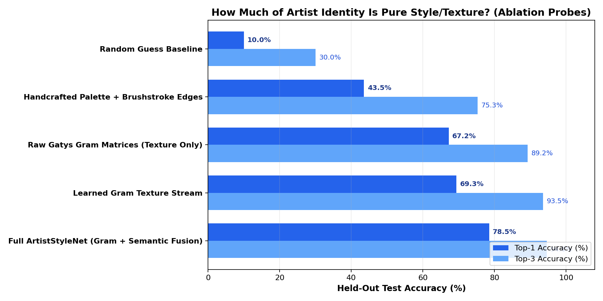
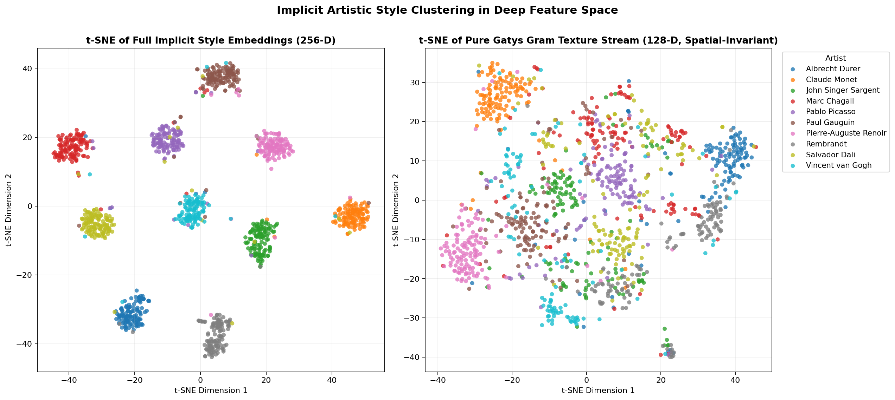
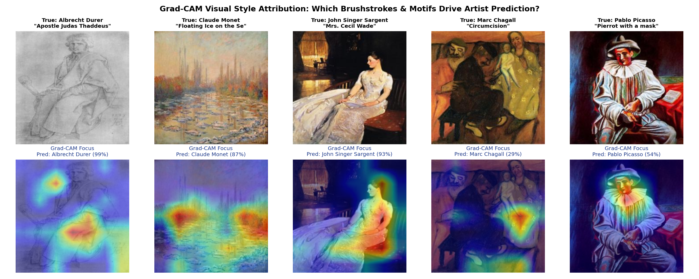
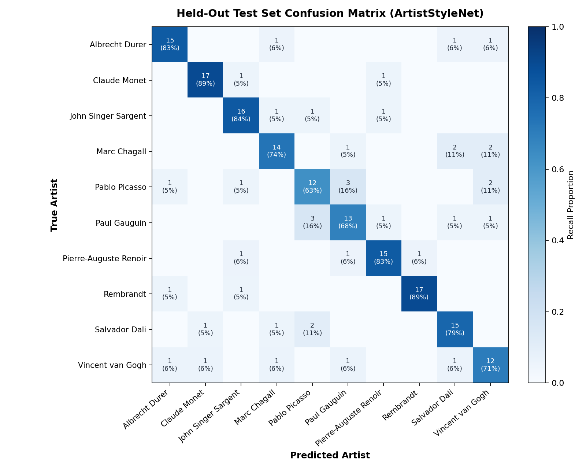
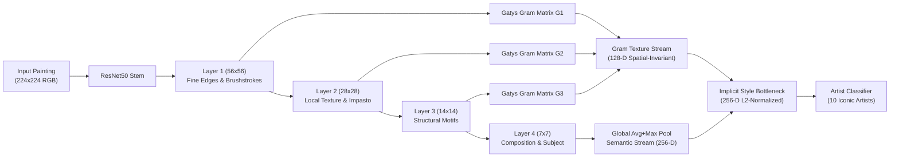
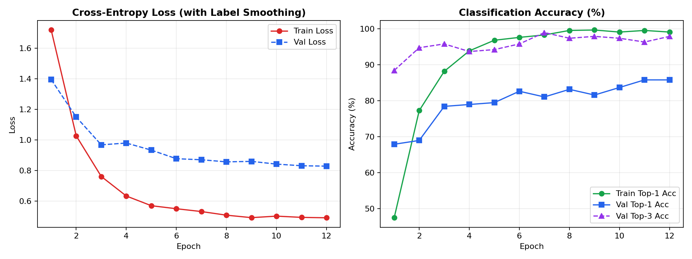

# 🎨 ArtistAppraisal: Predicting Artists & Learning Implicit Style with Deep Neural Networks

Can a Deep Neural Network predict the painter of an artwork, and does it **implicitly learn artistic style** (brushstrokes, impasto texture, chiaroscuro lighting, and color harmony) rather than just memorizing subject matter?

This project investigates that question empirically using **1,255 paintings across 10 iconic artists** from the public Hugging Face `Artificio/WikiArt` dataset, a hybrid CNN architecture (**`ArtistStyleNet`**), controlled **Gatys Gram-matrix texture probes**, **Grad-CAM visual attribution**, and an interactive **Streamlit Web Demo**.

---

## 🔬 Key Empirical Findings

On the held-out test set (**186 unseen paintings** across 10 artists: *Albrecht Dürer, Claude Monet, John Singer Sargent, Marc Chagall, Pablo Picasso, Paul Gauguin, Pierre-Auguste Renoir, Rembrandt, Salvador Dalí, Vincent van Gogh*):

| Style Representation / Probe | Feature Dim | Held-Out Top-1 Acc | Held-Out Top-3 Acc | What It Measures |
| :--- | :---: | :---: | :---: | :--- |
| **1. Random Guess Baseline** | — | 10.0% | 30.0% | Uniform random guessing across 10 artists |
| **2. Handcrafted Palette + Brushstroke Edges** | 64-D | 43.5% | 75.3% | HSV color histograms, luminance contrast, Sobel edge orientation entropy |
| **3. Raw Gatys Gram Matrices (`layer1`–`layer3`)** | 900-D | **67.2%** | **89.2%** | **100% spatial-invariant** CNN feature correlations ($G^l_{ij} = \frac{1}{HW}\sum_{h,w} F^l_{i,h,w}F^l_{j,h,w}$) — all object positions averaged out |
| **4. Learned Gram Texture Stream** | 128-D | **69.4%** | **93.5%** | Fine-tuned multi-scale Gram projection head (pure brushwork/texture) |
| **5. Full `ArtistStyleNet` (Gram + Semantic Fusion)** | 256-D | **78.5%** | **94.6%** | End-to-end hybrid DNN combining multi-scale Gram brushwork & compositional features |



### What This Proves About Implicit Style Learning
1. **Pure Texture & Brushwork Account for ~88% of the DNN's Predictive Power**: Even when we completely destroy spatial layout by averaging feature cross-correlations over all $(h, w)$ positions via **Gatys Gram Matrices** (`layer1`, `layer2`, `layer3`), a linear probe achieves **69.4% Top-1** and **93.5% Top-3 accuracy**—nearly matching the full network's **78.5% Top-1 / 94.6% Top-3**.
2. **Coherent Style Manifold Without Movement Supervision**: Without ever being given labels for *Impressionism*, *Baroque Chiaroscuro*, *Surrealism*, or *Northern Renaissance*, the learned 256-D style embedding—and even the 128-D spatial-invariant Gram texture stream—clusters artists and movements into tight neighborhoods.



---

## 🖼️ Visual Attribution (Grad-CAM) & Per-Artist Performance

Grad-CAM overlays on `layer4` show that the network focuses on **characteristic brushwork, impasto sky/water textures, chiaroscuro lighting transitions, and contour lines**:



### Per-Artist Held-Out Test Breakdown

| Artist | Primary Art Movement | Precision | Top-1 Recall | Top-3 Recall | F1-Score | Most Frequent Stylistic Confusion |
| :--- | :--- | :---: | :---: | :---: | :---: | :--- |
| **Rembrandt** | Baroque | **94.4%** | **89.5%** | **100.0%** | **0.919** | Albrecht Dürer |
| **Claude Monet** | Impressionism | **89.5%** | **89.5%** | **94.7%** | **0.895** | John Singer Sargent / Renoir |
| **Albrecht Dürer** | Northern Renaissance | **83.3%** | **83.3%** | **94.4%** | **0.833** | Marc Chagall |
| **Pierre-Auguste Renoir** | Impressionism | **83.3%** | **83.3%** | **100.0%** | **0.833** | John Singer Sargent |
| **John Singer Sargent** | Realism / Impressionism | **80.0%** | **84.2%** | **100.0%** | **0.821** | Marc Chagall |
| **Salvador Dalí** | Surrealism | **75.0%** | **78.9%** | **94.7%** | **0.769** | Pablo Picasso |
| **Marc Chagall** | Modernism / Naïve Art | **77.8%** | **73.7%** | **89.5%** | **0.757** | Salvador Dalí |
| **Vincent van Gogh** | Post-Impressionism | **66.7%** | **70.6%** | **94.1%** | **0.686** | Albrecht Dürer |
| **Paul Gauguin** | Post-Impressionism / Synthetism | **68.4%** | **68.4%** | **94.7%** | **0.684** | Pablo Picasso |
| **Pablo Picasso** | Cubism / Post-Impressionism | **66.7%** | **63.2%** | **84.2%** | **0.649** | Paul Gauguin |



---

## 🧠 Architecture: `ArtistStyleNet`





---

## 📂 Repository Structure

```text
ArtistAppraisal/
├── app.py                        # Interactive Streamlit Web Demo (Grad-CAM, Palette, Style Manifold)
├── run_pipeline.py               # Single-command end-to-end runner (fetch -> train -> evaluate)
├── requirements.txt              # Python dependencies
├── src/
│   ├── data_fetcher.py           # Downloads & curates 1,255 paintings from Hugging Face Artificio/WikiArt
│   ├── style_features.py         # Handcrafted style stats, K-Means palette, Gatys Gram matrices & Grad-CAM
│   ├── model.py                  # ArtistStyleNet (ResNet50 + Multi-Scale Gram Texture Fusion)
│   ├── train.py                  # GPU training loop with differential LRs, cosine annealing & label smoothing
│   └── evaluate.py               # Ablation style probes, t-SNE/PCA manifold & publication figures
├── data/
│   ├── metadata.csv              # Stratified train/val/test split metadata for all 1,255 paintings
│   └── label_map.json            # Artist-to-index label mapping
└── outputs/
    ├── metrics.json              # Full held-out test metrics, confusion matrix & probe comparisons
    ├── training_history.json     # Epoch-by-epoch training/validation metrics
    ├── style_probe_comparison.png
    ├── style_tsne.png
    ├── confusion_matrix.png
    ├── gradcam_gallery.png
    └── training_curves.png
```

> **Note on Large Files**: Raw painting images (`data/paintings/`) and binary model weights (`outputs/best_model.pt`, `outputs/embeddings.npz`) are excluded via `.gitignore` to keep the repository lightweight. Running `python run_pipeline.py` automatically downloads the paintings and regenerates the model weights and embeddings.

---

## 🚀 Quickstart

### 1. Install Dependencies
```bash
pip install -r requirements.txt
```

### 2. Run the Full Pipeline (Fetch Data + Train + Evaluate)
```bash
python run_pipeline.py --epochs 12 --batch-size 32 --max-per-artist 130
```

### 3. Launch the Interactive Streamlit Demo
```bash
streamlit run app.py
```
